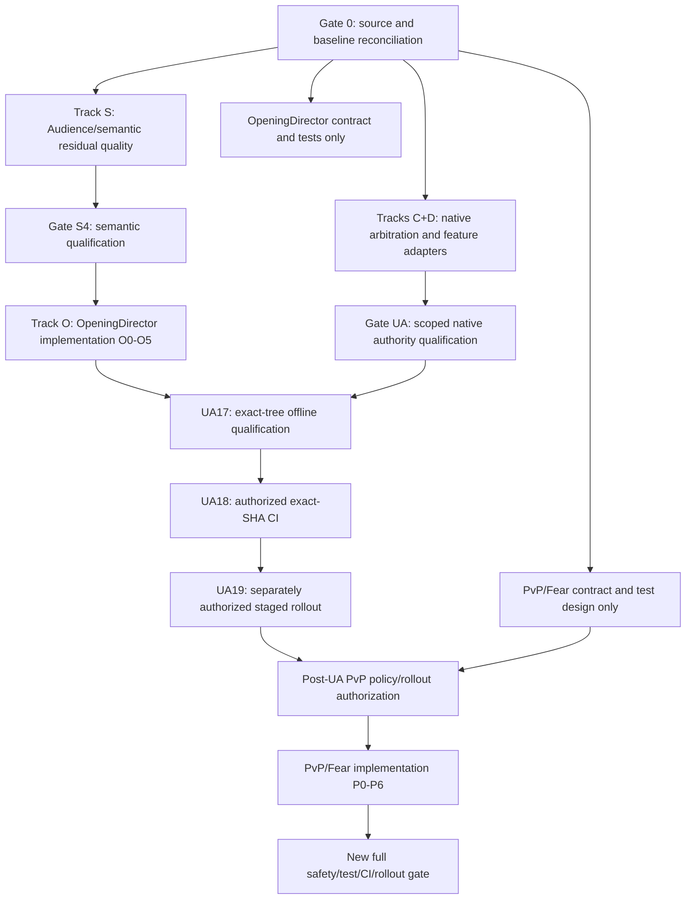

# Veiled City — Consolidated Multi-Agent Implementation Plan

**Plan version:** 1.3 · **Prepared:** 2026-10-17  
**Repository:** https://github.com/KeshireTheChaotic/Veiled_City  
**Canonical integration branch:** `codex/audience-first-narrative-v9`  
**Observed branch HEAD:** `47c5d35f90df2e5a69e406e857bbc946ce0957bf` (October 17 document consolidation)  
**Previous code checkpoint / active docs baseline:** `014bc39dadd4035b43649c2c24ef3508939b1c40`  
**Separate semantic branch:** `codex/semantic-language-robustness` at `6de758c95f94fa5895f9d14bc05970922b050b44` — already an ancestor of the canonical branch (**48 commits behind** at comparison).  
**Default-branch HEAD when inspected:** `main` at `30fb4d83e4c87abc38e3def467a042f64fc1627c` — not the integration target.  
**Status:** executable engineering plan; no code, tests, deployment, or production state modified by creation of this document.  
**Cadence:** coordinator + six specialist subagents, isolated Git worktrees and sequenced integration gates. Runtime World Director uses batched native services, NOT six independent model agents.

> **Governing rule:** An authenticated human declaration owns player intent, **not world authorship**; the AI GM interprets and selects only supported GM rulings; the native engine owns rules, RNG, resource/state mutation and immutable receipts; Audience-First v9 owns narrative generation, proof, task satisfaction, visibility and publication. OpeningDirector schedules these services but grants no new authority. Never substitute model prose, a role flag, or a plausible result for proof.

## 1. Objective and non-goals

Consolidate **all known unfinished or deferred work** from five lines of design into one implementable backlog: (1) Audience-First/semantic correctness and retirement, (2) OpeningDirector O0–O5, (3) unified GM arbitration and native feature coverage, and (4) coarse-to-fine, bidirectional AI World Director integration, and (5) the separately deferred autonomous PvP/Fear contract. Deliver a dependable scene-opening and multiplayer turn lifecycle, fluid language comprehension, autonomous but rules-grounded adjudication, transparent pre-roll Fear expenditure, and resilient delivery/recovery.

**Do not redo qualified capabilities:** Audience-First F0–F7/AR0–AR5 core, semantic S0–S6, narrative correctness R0–R6/D0–D3, assembly v2 source-fresh hook publication, basic native PvP attacks/damage/death, the 12 specifically supported native feature handlers, existing native NPC d20 attack/Armor/death, and historical receipt readers. The active ledger documents these as implemented to various degrees; the **latest combined tree still lacks whole-branch qualification**.

**Do not inadvertently ship policy changes:** Current bilateral PvP consent and immediate on-action-Fear semantics must continue to work until the separately reviewed PvP/Fear redesign explicitly replaces them. Disabling a review-only GM shortcut must never waive an actual player choice, out-of-game safety boundary, admin delegation requirement, secrecy constraint, or missing native feature adapter.

## 2. Current facts and outstanding delta

| Subsystem | Verified baseline | Remaining delta / disposition |
|---|---|---|
| Audience-First narrative | Native source/task/actor/audience scaffolding; F7 offline qualification at `c600349b...` (126/126 mandatory on **that** SHA), later work extends it | Quality corpus and independent per-obligation semantic coverage; latest executable tree final validation; real limited pilot later |
| Semantic S0–S6 | Semantic branch qualified 122/122 on its own SHA and is an ancestor of current integration branch | Residual NC20–NC22 style referential/sensory/attributed-English positives; unseen paraphrases; calibrated fallback; do **not** weaken DQ04/PVP30/OBS21 |
| Narrative correctness R/D | R1–R4 locality, audience, actor memory, native tasks, artifact handling; current-producer retirement D1; legacy readers retained; D3 separately qualified | N05/N06 guards may still create false holds; N13 mixed-OOC/fast-path tradeoff, N14 long-horizon salience, N15 owner-controlled appearance not generally implemented. Check later native construction tests before claiming any exact phrase remains broken |
| Assembly v2 | Current hook plan, source freshness, entitled private/public publishing, truthful fallback and replay rules | OpeningDirector orchestration: pre-start presence, automatic start/open, late arrival/absence/exit/reentry and convergence; eliminate mandatory manual assemble |
| Autonomous World Director | Present scene/round pass, city/faction/NPC simulation, source-backed mundane NPC/location creation and weighted narrative salience exist but require fragmented flags/reviews | Tiered L0–L3 simulation, bounded aggregate pulses, bidirectional source-typed Audience-First bridge, **weighted GM-invented detail → established/canonical identity lifecycle with an explicit player-world-authorship firewall**, automatic native authority for supported NPC/world actions and encounters |
| Unified arbitration | `gm-unified-arbitration.js`/`gm-arbitration-contract.js`, ordinary no-roll GM rulings, supported NPC attacks, player-owned pending rolls | UA14 human-GM *rule-source* migration, UA15 narrow routine world/encounter/evidence authority, exact native feature subfamilies; no blanket `gm:true` replacement |
| Special NPC/environment features | Catalog 153 occurrences = 12 supported + 140 review-only + 1 needs-authoring at documented checkpoint | Source-by-source design/adapter/test backlog, prioritized and separately scoped; never turn all 141 into executable via generic d20/JSON mutation |
| Existing PvP and death | Narrative contests, native damage-enabled profile, Evasion/Armor/HP and owner-selected Risk It All / Avoid Death / Blaze of Glory | New AI-GM-initiated PvP with **no additional bilateral PvP permission ceremony**; choice of damaging attack vs non-damaging contest; preserve genuine player voluntary options and safety controls |
| Fear | Immediate validated consequence of qualifying PvP action Fear already exists; bounded automated post-roll consequences exist | Add a **separate** GM Fear-spend pre-roll interrupt ledger: reserve → announce exact spend/move publicly → native apply → unlock player roll; avoid double charging or post-roll conflation |
| Release | Latest plan lists UA17/UA18/UA19 as open | Frozen-tree offline validation → same-SHA remote CI → separately authorized rollout and live pilot; subsequent PvP redesign must itself earn new qualification |

### Current source entrypoints

- Narrative: `bot/src/narrative-authority.js`, `narrative-tasks.js`, `narrative-tasks-v9.js`, `narrative-completeness.js`, `narrative-speakers.js`, `narrative-acts-v9.js`, `narrative-writer-v9.js`, `pvp-output.js`.
- Session: `assembly-state.js`, `assembly-readiness.js`, `assembly-planning.js`, `assembly-publications.js`, `assembly-delivery.js`, `scene-entry-native.js`, `command-definitions.js`, `commands.js`, session persistence and publication outbox.
- Mechanics: `gm-unified-arbitration.js`, `gm-arbitration-contract.js`, `rules-arbitration.js`, `pc-incoming.js`, `pc-death.js`, `native-feature-definitions.json`, relevant `native-*` feature executors.
- PvP: `pvp-profiles.js`, `pvp-rounds.js`, `pvp-attacks.js`, `pvp-damage.js`, `pvp-reactions.js`, `pvp-brawl.js`, `pvp-fear-gate.js`, `pvp-fear-moves.js`, `pvp-output.js`.
- Current operational docs: `docs/Active_Implementation/` and `docs/Setup_and_Scope/`; compare current code and tests with docs explicitly pinned to `014bc39d...`, not the newer docs-only HEAD.

## 3. Codex team topology

**Coordinator / integrator (Agent 0):** owns the master dependency graph, branch/worktree allocation, interface contracts, plan changes, final merges, migration/same-tree test gates, release ledger and operator handoff. No subagent directly changes the production branch or production database. A coordinator may use less concurrency if Plus usage is constrained.

| Specialist | Ownership | Primary deliverables | Cannot independently change |
|---|---|---|---|
| **A — Semantic & Audience Quality** | Unresolved semantic claims, task coverage, narration quality benchmark, nonbinding expressive composition, narrow current-producer cleanup | Adversarial quality corpus, source-verified composition roles, parser/projection patches, red/green tests | Player authority, dice/results, global safety disablers, legacy readers |
| **B — Session / OpeningDirector** | O0–O5 lifecycle and command sequencing | Attendance state machine, automatic start/open job, late presence/exit/reentry, recovery and migration tests | Creative validation, consent ownership, silent PC movement |
| **C — Native Arbitration / Permissions** | UA14–UA15 gateway inventory and supported native GM authority | Sealed GM-source adapters at producers **and readers**, narrow world/encounter/evidence transitions | Admin policy, optional owner choices, PvP rules before policy gate |
| **D — Mechanics & Feature Catalog** | Remaining UA7–UA12 native reaction, condition, defense, catalog subfamilies | Exact source-pinned handler adapters, reaction-window timing, composite odds, grouped child receipts | Blanket feature promotion, made-up rules, simulated player responses |
| **E — PvP & Fear Protocol** | Deferred redesign contract and, **after gate**, implementation | PvP action classification, no-extra-bilateral-consent migration, Fear reservation/announcement protocol, versioned compatibility | Existing production behavior before PvP release gate; PC-authored rolls, Armor/death selections |
| **F — Test, Security, Delivery & Release** | Crosscutting invariant tests, outbox, performance, CI/release playbook | Safety matrices, provider/Discord fake tests, frozen-tree qualification, diagnostics, replay/rollback | Mutating other agents' branches to force a green report; independent approval of release |

**Ownership mechanics:** one worktree per agent from the same observed SHA; explicit file/symbol ownership and an integration branch for reviewed changes. Agents exchange API contracts, fixtures and test results—not ad hoc edits to each other's worktrees. Coordinator performs all conflict resolution. Use narrowly scoped commits with source/test changes and before/after behavior. Temporary feature flags default to existing behavior and cannot authorize mechanics.

**Concurrency:** six specialists can work concurrently on *independent analysis, tests and specs*; executable integration follows the gates below. On a Plus usage budget, prioritize A/B/C/F for the early cycle and defer E's code generation until the PvP policy gate. Do not equate `max_concurrent_threads_per_session` configuration with a guaranteed plan entitlement.

## 4. Master dependency map and release trains



**Policy sequencing is intentional:** the existing `ACTIVE_IMPLEMENTATION_PLAN.md` defers substantive PvP/Fear redesign until UA17–UA19, so E can investigate/spec/test in parallel, but **must not land switched runtime semantics earlier**. If the owner later expressly revises this gate, record the approved change and its safety consequences before advancing.

### Gate 0 — Reconcile actual source before edits (Coordinator + F)

1. Read HEAD, `git status`, untracked owner files, commit ancestry, current slash-command registrations, production config only if separately approved read-only.
2. Diff `main`, semantic ancestor and current Audience-First; **do not merge the semantic branch again or reset to main**. Confirm October 17 document consolidation is not a code-quality qualification.
3. Run installed package baseline `npm ci`, `npm run check`, `npm run quality`, `npm run format:check`, `npm run validate` as appropriate to the actual package scripts. Use disposable SQLite, fake provider, fake Discord, network-denied tests; capture exit status and machine-readable reports. Do not claim tests passed if not executed.
4. Build a source+test+native-reader reachability graph and a de-duplicated backlog issue matrix: `status = done | partial | red | pending adapter | deliberate hold | product decision`.
5. Agree on source/receipt schema compatibility, versioning, locked API contracts, and file ownership before parallel code edits. No user database mutation.

**Gate 0 exit:** a reproducible exact-SHA baseline, legacy test preservation inventory, current bug reproductions, no accidental reimplementation of old work.

## 5. Track S — Remaining Audience-First + semantic improvements (Agent A; F verifies)

**S0 — Corpus & semantic baseline.** Recover previous N01–N15, NC20–NC22, DQ04, PVP30, OBS21, SEM06, assembly and audience integration fixtures. Mark N01–N04/N07–N12 items that R/D and later F7 already repaired. Build task-labeled multi-actor variations: aliases also ordinary nouns (e.g., *Rain*), questions *about* a PC, direct address versus PC speech, harmless sensed surroundings versus imposed emotions, evidence hearsay versus fact, 0/1/N NPC answers, off-scene voices, camera unplaced, late arrival, held sibling versus valid sibling, flags-off compatibility, restart and retraction. Include adversarial paraphrases, different punctuation, multiple sentences and contradictory clauses. Baseline real source output and **completion per exact obligation**, not just one narrative success boolean.

**S1 — Bounded semantic interpretation experiment.** Compare the existing same-call interpreter/author with a tightly bounded independent interpretation pass in offline tests. Prefer **no additional model call** unless measurable accuracy/latency benefit justifies one. Classify `physical observation`, `NPC attributed claim/offer`, `PC quoted/reference`, `player action`, `character sensation`, `mechanical consequence`, `visibility`, `knowledge` as evidence-backed task facets. Model classifications are proposals only; native proof and source-bound construction remain final. No LLM-written arbitrary safety exception.

**S2 — Evaluation and selection.** Compare false-hold rate, false-authorized-PC-claim rate, per-task completeness, NPC answer/continuity, audience disclosure, source-locality, token/call budget and p95 latency using a labeled fixed corpus, held-out paraphrases and current renderer replay. Reject any approach that improves prose by allowing a P0 agency/privacy violation. Report actual numerator/denominator per category, not invented percentages. Keep low-confidence material scoped to review rather than silently suppressing unrelated native effects.

**S3 — Targeted remaining quality fixes.** Implement source-certified composition for remaining ambiguous benign references and sensory phrasing **only if** positive/negative evidence distinguishes it from a true PC agency/secret/harm assertion. Preserve DQ04's surrendered-PC negative, unknown audience/source protections and historical readers. Resolve duplicate and missing answers by native task/target IDs; no task is "complete" merely because another NPC said something. Keep synthetic NPC cognition separate from audience disclosure. Remove only demonstrably unreachable current interpretation producers after one-to-one assertion parity; retain old record versions and flag-off routes.

**S4 — Qualification gate.** Freeze semantic implementation and quality corpus. Pass security, exact task-coverage and flag-off/legacy tests. Require scenario coverage for benign Rain/weather and mention-of-PC examples **without** enabling compelled PC speech; if proof impossible, leave a deliberately held, documented quality limitation with a failing *optional quality* probe rather than cheating a mandatory safety test. Publish exact corpus metrics/call counts, reference SHA and limit of fake-model evidence. **Only after S4 may B integrate O1–O5.**

**Separate product decisions (not default security-bypass work):** N13 mixed OOC and one-call fast path, N14 long-horizon salience strategy, N15 explicit owner-authored PC appearance/disclosure. Agent A produces proposals and bounded optional tests; implement only within their own authority contract and explicit accepted scope.

## 6. Track O — OpeningDirector O0–O5 (Agent B; A/C/F review)

> OpeningDirector is an **orchestrator**, not another narrator, rules authority, semantic censor, or publication gate. It invokes existing Assembly/Audience-First/TypedIntent/PublicationOutbox services. There must be one source of narrative validation and one native source-of-truth for attendance, fictional placement and owner agency.

**O0 — Source map/state machine and backward compatibility.** Derive actual `start`, `present`, `roster`, `assembly-status`, `assemble`, `arrive`, `absent`, `leave`, `converged` semantics from command code. Specify versioned lifecycle: `pre_session / registered_presence / started_waiting_open / opening_pending / opening_published_or_fallback / active / absent / left / reentered / ended`. Distinguish campaign member, PC attendance, scene placement, fictional arrival, proxies and voluntary party affiliation. Test duplicate, stale and concurrent calls before code.

**O1 — Unified `/vc-session present`.** Permit **pre-start declarations** against the next supported session context without creating a fictional arrival, movement, co-location or automatic party membership. After start, the same command records **late attendance** and prepares a private/director entry opportunity, not compelled walking into the shared scene. Idempotent per character+session+owner revision; preserve replacement/guest, absence, reentry and stale principal behavior. Current legacy `/vc-session arrive` remains as compatible owner-controlled fictional entry/native location route until intentionally retired.

**O2 — Automatic `/vc-session start` → assembly/opening scheduling.** `start` seals the initial attended roster and creates **one durable native opening job**, with a logical event identity keyed to session/start revision. Support 0, 1, many attendees: (0) establish an honest opening camera/world state without inventing a PC; (1) owner-entitled solo hook; (many) bounded shared camera + separately entitled personal hooks. No manual `/vc-session assemble` prerequisite. Retain `assemble` as GM-safe inspect/retry/recovery command that does not create duplicate messages or reset prepared owner decisions. Do not require checked-in NPC or all players to be present to open a session.

**O3 — Durable publication and recovery.** Native planning → Audience-First authoring → per-obligation completion → source/recipient verification → persisted outbox with explicit `prepared/queued/acknowledged/unsent/uncertain/held` states. Distinguish `SOURCE_HOOK_DELIVERED`, `VERIFIED_SCENE_DELIVERED`, `FALLBACK_DELIVERED`; fallback is not a personal hook. Revalidate roster/principals/location/import/hook/content/visibility at send and restart. On model timeout, queue exactly one bounded recovery attempt or an honest GM-facing hold, never endlessly send “still working” without a final user-visible opening or diagnostic. An uncertain transport never blindly resends.

**O4 — Late entry/exit/reentry and convergence.** Owners' `present`, `absent` and `leave` update **attendance**, not diegetic travel. New entries may receive safe private introduction opportunities based on current scene and optional declared PC intent. No forced PC dialogue/reactions, immediate teleport, synthetic knowledge or retrospective arrival. Reentry reuses valid previous state/receipts while generating a new authorized point of engagement if warranted; preserve NPC/player scene continuity and independent turns. `/vc-session converged` records legitimately established shared objectives, not forced party consent; `/vc-party establish` remains voluntary. Play from unaffected participants must continue while one character's introduction is pending.

**O5 — Full OpeningDirector acceptance.** Four-player replay with pre-start 0/1/N, two duplicate presents, late join/exit/rejoin, proxy change, stale import, source revocation, disabled DM, partial public/private output, uncertain delivery, crash after commit before send, multi-turn scene continuity, party converged/not converged. Verify no duplicate opening, no unconsented placement/PC act, no secrets, no deadlock, and accurate operations UI/docs. Add a deterministic failure matrix for the previously observed Session 5 "still working"/missing scene symptom without inventing its original live root cause.

## 7. Track UA — Arbitration, native authority and feature coverage (Agents C + D)

### UA-A — Finish previously partial UA7–UA12 native features (D)

- **Native timing, conditions and reactions:** exact trigger stage (`before_attack`, `after_hit`, `before_damage`, `after_damage`, later spotlight), source identity, bounded depth, condition clearing and expiration, zone/range/movement step receipts, actual Stress overflow, current owner choice and source/recall; no generic reaction executor.
- **Composite/group math:** Stack Formation remaining-HP transitions + Tag Team proof; combined Local Mesh/aura probability; target-specific Vulnerable odds for Coordinated Volley; deterministic shared-roll parents with independently owner-confirmed Armor/reactions/HP/death children. A waiting sibling must not block independently valid results.
- **Named pending feature handlers:** Route Around powered destination/final-HP priority; Signal-Touched suppression choice; Spend Forecast owner-selected single-d12 reroll; Invitation Revoked hospitality breach; Blackout/Three Vectors; richer local environment and group conditions. Implement only where the original source and campaign rulings specify exact rules. Unknown or ambiguous effects get scoped `review_only`, not fictional success.
- **Catalog backlog:** revisit 140 `review_only` plus 1 `needs_authoring` occurrence. Prioritize by live encounter exposure, correctness impact, source certainty and code-family reuse. Each promoted occurrence requires the original text/template hash, native handler, owner/cost/timing proof, positive and adversarial negative tests and readback. Preserve 12 previously supported definitions and historical proof readers. The backlog is **not a pretext** for postponing OpeningDirector until every obscure encounter feature exists.

### UA-B — Human-review gate audit and migration (C, source/consumer crosswalk)

Audit **both producer and every consumer** for artificial `human-reviewed` approvals versus essential human ownership: GM-sourced Difficulty/modifiers, attack eligibility/equipment mapping, alternate traits, Help/Tag Team feasibility, Experience and supported feature costs, neutral roll Difficulty, effect readback, replay, disclosure and outbox. Install a sealed authenticated native GM origin/capability with exact source, rule, target, scene, principal/version and spend proofs; never trust `gm:true` in model JSON. Maintain all old human-authored receipt readers. Migrate only supported substantive rulings; do not remove actual player choices for dice, reactions, Help, Armor, Hope, Experience/Stress, surrender, proxies or death moves.

### UA-C — Bounded autonomous-world operations (C)

Extend **ordinary GM** actions on source-proven native rules separately from *administrative delegation*: legitimate no-roll scene rulings; NPC goals and civilian behavior; authorized encounter proposal/activation; limited mundane movement, evidence analysis and policy-allowed civic/service effects. Admin configurations, controversial canon, contested custody, major faction actions, restricted travel, funding, seed data, server settings and global policy remain operator/authority gated. A simulation score does not grant physical-combat authority. No generic JSON mutator or template-less hostile PC harm.

### UA-D — Acceptance and implementation sequencing (C+D+F)

Each increment: (a) original rule/source identifier and exact allowed mapping; (b) red-first reproducible fixture; (c) success through actual saved native state/dice/cost/outbox; (d) wrong-owner, stale, hidden, changed template/equipment/HP, insufficient-resource, unsupported, replay and restart negatives; (e) targeted unchanged-original test suites green; (f) evidence and status-only catalog update. Track true `unsupported` or `needs_authoring` entries explicitly. Changes to mutable native schema require additive versioned readers and replay migrations—never destructive state rewrites.

## 8. Track WD — Granularity-aware, bidirectional World Director (Agents C + A + D; B integrates; F validates)

**Governing design:** [World Director ↔ Audience-First contract](VEILED_CITY_WORLD_DIRECTOR_BIDIRECTIONAL_DESIGN_v1_2.md) (companion artifact). Use hybrid **Unified AI GM + Autonomous Actor goals + Event-Driven native execution**, not one agent or DB row per NPC per tick. Relevant scene NPCs and encounters gain full resolution only on demonstrated player/scene relevance.

**WD0 — Inventory and source authority:** Map city, faction, institution/organization, NPC, encounter and legacy delegation producers **and all consumers**; preserve native historical records. Baseline database writes, provider calls, per-turn context tokens, and long-running simulation cardinalities. Catalogue every required toggle/review and distinguish routine AI-world rules from player, human proxy, canon/privacy and administrative controls.

**WD1 — Tiered L0–L3 world model:** L0 persistent coarse district/faction state; L1 only salient active world projects/actors; L2 detailed scenes/NPC knowledge; L3 actual source-grounded native encounter participants/resources. **Reuse the narrative engine’s weighted salience/decay to promote and demote detail, and allow ordinary temporary inventions to become established canon automatically when native evidence supports them.** Persist aggregated meaningful revisions and native consequential receipts; never log every discarded idea, per-NPC tick or repeated empty summary. No background per-NPC model calls; bounded batch opportunities and native deterministic progress.

**WD2 — Bidirectional typed `WorldNarrativeBridge`:** Audience-First → Director emits typed player claims/questions (non-authoritative) and authenticated **resolved** player intents, witnessed/heard events, attributable NPC dialogue, native scene transitions and explicitly non-authoritative narrative-coverage diagnostics. Director → Audience-First emits current world consequences, source-backed NPC offers, playable scene beats, encounter candidates and pacing cues. A proposal never impersonates an established event. Revalidate source, audience, speaker knowledge and actor control at **both** ports and publication. Use additive versioned sidecars, not historical v8/v9 record rewrites.

**WD2S — Weighted invented-detail lifecycle (A+C; D/F integration):** Wire `narrative-salience.js` (current weighted interest, fictional-time decay, pins, `prompt_archived`), `memory-lifecycle.js` (identity/epistemic revisions), and `autonomous-world.js` (current source-backed NPC/location materialization) into the same Director opportunity selection as `WorldNarrativeBridge`. The AI GM may invent an ordinary NPC, faction, organization, district or local place when a narrative need calls for it, first reusing a compatible existing identity. Record only the minimal identity/parent/audience/provenance necessary at low importance; **repeated, distinct, authenticated player engagement with an already independently established world entity, plus verified world effects, may raise weight and automatically establish/pin canonical ordinary identities and independently supported mundane facts**. Mere repetition of model prose, rumors, aliases, or GM-private context must not create objective truth. Named rumors can be canonically *rumors* without proving their subject. Native effects, control, resources, jurisdiction, geographic access and encounter templates still need their separate adapters. Fade low-weight invented detail from active context and simulation; never erase source-backed history or demote a committed canon fact into nonexistence. See companion weighted-canon contract for scoring, source dedupe, safe automatic promotion, sparse storage and edge-case tests.

**WD2A — Player authorship and creation provenance firewall (A+C; D/F tests; REQUIRED before WD2S auto-canon):** Ordinary player speech, typed `player_intents`, scene descriptions and unapproved claims can propose interactions or questions but **must never create or canonize** an NPC, faction, organization, district, location, resource, relationship, secret or event. The exceptions are **authenticated GM-private-hook imports**, **the existing authorized relationship workflow**, and **explicit canon proposal/acceptance workflow**, each constrained by its real actor, scope and current native proof. Hooks remain GM-private until independently disclosed/materialized; relationship claims need real endpoints and cannot author another person's feelings/control; player canon proposals do not bypass their canon approval/conflict pathway. Implement a server-only `authorship_origin_v1` classification or equivalent sealed GM/native issuer proof at both proposal and commit, plus every reader and publication projection. Explicitly inspect `entity-memory.js:tierWorldAdditions` (player text/intent target currently retains a proposed addition), `typed-intents.js` same-turn names, `autonomous-world.js`, `scene-intent-board.js`, `memory-lifecycle.js` and `narrative-salience.js`. Player-repeated assertions may be attributed statements/rumors, **never independently created reality or sufficient establishment weight**. Independently justified native AI-GM invention, even when prompted by an open-ended player need, remains allowed and enters the normal weighted lifecycle. No additional per-player model call or speculative persistent object is required. The exception workflows are **not** weakened by removing routine world-simulation approvals.

**WD2A acceptance:** false assertions repeated across multiple turns create zero new entities/canon/weight-based promotions; unknown named contact in player dialogue remains a request/claim; legitimate native GM invention persists exactly once and later reuses weighted salience; authorized private-hook, accepted relationship and accepted canon produce correctly scoped records; unapproved private material does not leak or mint authority; fake GM role, stale revisions and forged source receipts cannot bypass native issuance; same-turn reference and restart/legacy readers fail closed. Independent valid player actions proceed when an invented-object sibling is held.

**WD2S acceptance:** ordinary NPC/location invention reuses existing source-bound establishment, while new faction/district identity proposals use new bounded adapters rather than invented stats; independent player interactions move transient→recurring→established without GM toggle or approval; low-salience unused details retire reversibly; canon/pinned details persist without per-tick NPC simulation; rumors/private scenes do not become public/objective canon; duplicate narration does not self-reinforce score or generate DB rows; old v1 memory/salience receipts and readers remain valid.

**WD3 — Autonomous native world authority:** Replace default-manual `ai_delegation`, per-feature opt-in and routine human review where concrete actor/source/rules/target/resource adapters exist; no fake `gm:true` or blanket permission override. A high-impact world move may auto-resolve **only** with an actual bounded mechanic and actor capability. Missing adapter yields an independent scoped hold/alternative without blocking all play. Player-owned choices and property, proxy NPCs, out-of-game safety, secrets/canon, admin/retcon/deployment rights remain separately checked.

**WD4 — Encounter/OpeningDirector integration:** The same bounded Director can turn a credible L1 threat into local L2 scene opportunity and then L3 native encounter, using `encounter.js`, `scene-intent-board.js` and `gm-unified-arbitration.js`. Audience-First returns actual verified player/witness feedback to next opportunity. OpeningDirector consumes this coordinator at session opening/late-arrival/scene transition, **not a second simulation engine**. Existing current bilateral PvP/Fear mechanics remain untouched until separate P-series.

**WD5 — Durability + cost gate:** Confirm player-claim injection is blocked, sanctioned GM-private-hook/relationship/canon routes retain their native approval boundaries, and salience/canon transitions are idempotent and source-bound, no feedback-loop event recursion, no unproven world claims, exactly-once simulated native consequences and outbound notifications after failure/restart. Measure write amplification, rows/scope, source bytes, prompt tokens, call count, latency and output completeness with equivalent synthetic story traces. Initial tunable ceilings: 4 active world scopes, 8 named actor candidates, 4 proposals per opportunity; 0 L0 model calls and prefer no additional model calls in existing scene turns. These are budget hypotheses to benchmark, not promises or present config.

**Implementation order:** WD0/WD1 contract design begins in W0/W1; WD2A player-authority firewall and WD2/WD2S reader-side signal, weighted lifecycle, and schema tests can parallel semantic work; WD3 requires UA14 native provenance and UA15 justified world adapters; WD4 depends on semantic qualification, supported encounters and OpeningDirector integration; WD5 joins W3 frozen-tree core gate. Runtime autonomous PvP/Fear change stays post-UA.

## 9. Track P — Deferred autonomous PvP and Fear (Agent E; begin execution only after post-UA gate)

### P0 — Explicit replacement contract and migration plan

Baseline distinguishes **existing narrative Duel/Three Strikes**, **v3 damage-enabled contract**, **post-action PvP Fear-trigger consequences**, and **new pre-roll GM Fear spends**. Capture the accepted owner decision: remove the extra bilateral PvP *consent ceremony* as a gate to ordinary in-fiction PC-vs-PC adjudication; AI GM classifies whether declaration is a harmless contest, a genuine damaging attack, or does not require a roll. A target's attack risk must be communicated through clear current scene/rules; do not pretend the existing bilateral record is still necessary, silently rewrite historical contracts, or bypass separate table-level safety/owner permissions. Version the runtime boundary and keep old saved contract/roll/receipts readable. Explicitly record any campaign-wide PvP safety toggles/stop policy and how they interact with existing sessions before activation.

### P1 — AI semantic PvP classification with native authority

For authentic player intent, classify: (i) no roll for trivial nonconsequential conflict; (ii) non-damaging contest/social opposition requiring agreed applicable mechanics, independent human choice of any actual reaction; (iii) damaging attack that uses current legitimate target Evasion and native damage/proficiency/threshold/range. Model chooses GM-owned appropriate method and stakes, **not** a guaranteed hit, invented active response, unauthenticated player attack or fabricated PC action. Tie actions to exact target and current scene. No universal free defender duality roll or implicit surrender. Keep brawl/FFA/team fair spotlights, target locks and independent bystander actions.

### P2 — No-extra-bilateral-approval mechanics adapter

Replace current authorization gates at **all** request, dice, damage, replay, injury, output and disclosure readers for *new-mode* PvP. Attack roll remains owner-authored and executed by the player; a defender can elect any genuinely supported voluntary reaction or native Armor option, and may respond or decline according to actual rule windows. An inactive/absent/offline owner never gets invented choices or a default mechanical failure; distinguish deterministic defense from optional participation. Native HP, stress, resistance, Armor, death request and owner-selected Risk It All/Avoid Death/Blaze of Glory remain unchanged. Do not promise guaranteed nonlethal damage (existing owner policy explicitly disabled that profile). PvP action rolls still award **zero Hope and no action-critical Stress clear**, unless an owner-approved future rules decision expressly changes it; ordinary non-PvP SRD rules remain independent.

### P3 — New GM Fear-bank reservation and **pre-roll announcement**

Introduce a **distinct, versioned `fear_spend_interrupt`** protocol separate from an action's Hope/Fear-result consequence. Only a genuine available GM Fear resource can fund it; first normal spotlight and feature-specific costs are independently accounted for. Before the affected player roll: validate current trigger/allowed GM move/actor/target/scene/cost; **atomically reserve** the token and roll window; enqueue a precise source-bound public announcement, e.g. “Veilkeeper spends 1 Fear: [specific permitted move, consequence and affected check].” **Do not open/accept the player roll until its announcement is positively acknowledged to the appropriate audience**. Then apply the native move/cost exactly once under the same reservation and release the roll window. The move must not retroactively edit saved dice, manipulate the player's d12, or impersonate the player. If delivery is failed/uncertain, remain pending for scoped reconciliation; if canceled before commit, release the reserved token with an audit receipt, not a duplicate spend. Source/scene stale, insufficient Fear, blocked move and restart must be safe.

### P4 — Preserve post-action Fear consequence separately

A qualifying attacker **action roll** showing Fear still creates an immediate, substantive validated GM move obligation, with no banked generic “fear point” and no cosmetic substitute. Independent simultaneous action Fear triggers create their own ordered effects; reaction rolls are **not** action-Fear triggers. Maintain bounded existing native scene clock/NPC threat/native attack pathways, prior resolved effects and restart proof; unsupported outcomes stay reviewed rather than disappearing. Verify before-roll GM-spend and post-action die-Fear do not double bill or cancel each other.

### P5 — Player-facing UI and transparent disclosure

Discord/private components show who may decide what: attacker authenticated roll; defender mechanically applicable private reaction/Armor; explicit Death Move choice; GM's public, pre-roll announced Fear expenditure with unchanged actual Fear balance provenance. No leaked HP, private secrets, individual hidden rolls or GM-only move rationale. Interrupt publication must precede roll enablement, not be delayed until after the dice were committed. Avoid narration of involuntary PC speech/emotion/consent. Offer active-stakes clarity in character sheets, `/vc-roll` pending/menu and scene messages.

### P6 — PvP/Fear dedicated qualification

Run old saved bilateral contracts alongside new-mode records; migration/flag defaults and feature gating; narrative duel/contests, harmful melee/ranged attacks, miss/critical/damage/death/Armor, 4-owner FFA/2v2, absent target, late join, ownership change, privacy, fake public-message failure/uncertain acknowledgement, Fear reserve/cancel/spend and two simultaneous Fear actions. Crash at every reservation/announcement/roll/effect boundary and recover exactly once. Repeat *all original* PVP30/q, FH40, OBS21, D08, original non-PvP Hope/Fear, no-fudging RNG/death, safety and negative agency tests. Full exact-tree validation, separately authorized remote CI and controlled live pilot are required **again** after this branch changes semantics.

## 10. Cross-cutting durability, performance and fairness (Agent F)

- **Native dice authority:** Before a requested roll publish actual stakes/Difficulty, trait, bonus and failure implications. Player rolls two natural Hope/Fear d12 through authenticated supported workflow; matching natural faces are Critical regardless of modifiers, with immutable roll receipts. AI GM rolls its authorized NPC d20 through native backend. A generated narrative never fudges, discards or rerolls committed dice.
- **Publication and confidentiality:** Separate prepared draft, validated source, committed mechanical effect, queued outbox, observed delivery and uncertain delivery. At every hop enforce actor, source, scene, owner, audience, knowledge, privacy and current revision. Long-running writer errors cannot block unrelated saved game actions.
- **Latency:** Compare fake-provider 1/2/3-call control paths against changed implementation; record actual production p50/p95 only during authorized pilot. Prefer one semantic adjudication within the existing GM call and bounded fast legitimate responses. Remove redundant *model* calls only when the native correctness/security cases still pass. Cheaper model routing is a follow-on measurement option, not an excuse to lose independent authority.
- **Recovery:** Always restore by source/receipt and durable idempotency keys, never by regenerating prior rolls, costs, PC choices or Discord messages. A fallback opening or partial narrative must not falsely mark all tasks complete. Limit stuck-turn statuses with final diagnostics and recovery controls.
- **Testing discipline:** All original mandatory tests remain registered/unchanged unless exact, justified migration; new red/green targeted tests per feature; test crashes and negative boundaries in disposable SQLite/fake Discord/fake LLM; no paid requests by default. Distinguish test suite count from actual assertions, and separate historical passing SHA from current passing SHA.

## 11. Integration waves and approval gates

| Wave | Parallel work permitted | Coordinator integrates when | Release implication |
|---|---|---|---|
| **W0** Baseline | A/B/C/D/E/F inventories, contracts and red fixtures; WD0 scope/write/call inventory | Current HEAD and rules/reader contract reconciled; original tests traced | None |
| **W1** Semantic correctness | A implementation and WD2/WD2S typed bridge + weighted temporary-detail contract; B O0 design/tests; C WD1 tier/pulse and native adapters; D native mechanics; E PvP/Fear design/tests; F safety/cost fixtures | S4 security + task-quality gate is green or explicit quality holds documented | No automatic deployment |
| **W2** Opening + native authority | B O1–O5 **after S4**; C UA14/UA15 + WD3 + source-backed weighted entity promotion; D prioritized catalog subfamilies and WD4 native encounter support; A source-typed narrative integration; F cross-suite replay | Interfaces stable; all original owner/secret/outbox tests green; unsupported catalog backlog explicitly accounted for | Prepare UA qualification |
| **W3** Core qualification | WD5 aggregate/API budgets, weighted canon/fade tests and anti-loop proof; F exact-tree full UA17; coordinator SHA pin; optional authorized CI UA18 and staged rollout UA19 | Zero mandatory failures/skips/not-run, exact SHA identity, reviewed operator authorization and backup/restore proof | Core release only, PvP semantics unchanged |
| **W4** PvP/Fear redesign | E implementation P0–P6; A language tests, C native gateways, D rule checks, F independent adverse tests | Post-UA redesign explicitly authorized, versioned record contract approved | New independent release candidate |
| **W5** PvP release | F full tests, CI exact SHA, consented live pilot/monitoring; coordinator doc/runbook | Zero P0 agency/privacy/incorrect dice/death/Fear/transport incidents and exact migration/restart proof | Separately approved PvP rollout |
| **W6** Long tail | D batch the remaining 141 catalog items, A optional N13–N15 features with owner-approved scope | Each feature promoted only with original rules evidence and its own native tests | Incremental, separately qualified |

**Critical path:** baseline → semantic S4 → OpeningDirector O5 plus required native authority integration → UA17 → authorized UA18/UA19 → explicit PvP/Fear policy gate → PvP P6 + new release qualification. Agents C and D progress in parallel, but their unresolved unsupported special-feature inventory is not treated as automatic permission for a generalized feature engine.

## 12. Concrete acceptance scenarios

1. **Zero-player start:** GM starts a session before anyone presents. One truthful opening is recorded/delivered, no phantom PC arrival or party membership. Later `present` schedules independent owned thread.
2. **Four-player mixed start:** two owners present before start, one after, one absent. Shared camera is consistent; personal hooks are separately entitled; unaffected players can take turns while late invitation is pending.
3. **Duplicate/restart:** start/present/assemble repeated and process crashes after publication reservation. Exactly one native opening identity, no duplicate published body; uncertain sends remain pending reconciliation.
4. **Semantic multi-question:** owner asks two distinct NPCs. Each task ID is answered, legitimately declined, unresolved or held independently. First answer cannot fake completion of second.
5. **PC agency and expressive narration:** “Rain beads on the window” / “Have you seen Raven?” can be narrated only via evidence-supported nonbinding construction; “Mr. Raven, you agreed to surrender” cannot invent a decision. A narrator may convey physical setting, not choose emotions/actions for the PC.
6. **NPC lethal attack:** native source/eligible target/defender Armor/actual saved damage reaches last HP; owner privately selects a death move; no model-invented death or double damage on restart.
7. **Autonomous PvP:** after explicit redesign rollout, an authentic player attack against another PC is not blocked by a **separate bilateral PvP opt-in**, but owner-specific optional choices and native constraints are preserved; choice of damage vs narrative contest is evidenced before rolling.
8. **Pre-roll Fear:** valid Fear resource → reserved and clearly announced to actual audience → exact permitted native GM move → only then player roll; duplicate buttons/restart/uncertain public delivery cannot allow unannounced mechanics or two Fear charges.
9. **Post-roll Fear:** attacker action Fear triggers one immediate native effect; reaction Fear does not. Two simultaneous attacker Fear outcomes preserve independent, ordered obligations.
10. **Unsupported feature:** an attempted Blackout/Three Vectors mapping with insufficient original rules remains precisely in review without generic d20, resource mutation or self-justifying prose.
11. **Native arbitration:** legitimate current GM-origin Difficulty/trait/narrow world operation requires no redundant manual GM attestation, yet forged model `gm:true`, revoked source, wrong owner and admin-only action still fail.
12. **Player world-invention firewall:** ordinary owner claim “My faction owns this district” or “My secret safehouse exists” cannot generate a new world entity, relationship, jurisdiction, access or canon, even after repetition and same-turn model echo. Authenticated GM/native invention and accepted hook/relationship/canon workflows can establish appropriately scoped identities with proof; weight applies only after permitted establishment.
13. **Transport vs truth:** valid game effect survives a blocked narration; source retraction holds further publication without unwinding already-saved native costs/dice; uncertain send never implies confirmed user delivery.

## 13. Definition of done and evidence ledger

A feature is **implemented** only when executable native code, current owner/source contract, both producer **and** consumer validation, positive+negative tested saved state, restart/replay, audience/projection proof, and scoped documentation exist. A test name, producer-only schema, model-generated sentence or a passing historical suite does not suffice.

For every completed incremental PR/commit, record:

```text
Task ID / specialist / parent SHA / result SHA
Files and symbols modified; source/rules fingerprints
Native read/write path and old-receipt compatibility
Baseline red reproduction and unchanged negative controls
Targeted command, actual pass/fail/skip/todo counts and exit codes
Publication/restart/outbox and security evidence
Provider calls / dollars spent (if any), DB/Discord/network exposure
Open variants / intentional holds / next dependent gate
```

**Release gate:** full `npm run check`, `npm run quality`, `npm run format:check`, `npm run validate`, manifest/diff check on a **frozen exact executable/test tree**, no mandatory skipped/not-run cases, D08/OBS21/PVP30/FH40 and native PC-state/death protections proven, followed only when authorized by same-SHA remote CI and staged deployment. Live tests are distinct from offline correctness and require owner approval, read-only audit boundaries and a validated SQLite WAL-aware backup/disposable restore. A push is not an install.

## 14. Coordinator's immediately executable first sprint

1. Create `codex/consolidated-director-arbitration` **from the inspected Audience-First branch HEAD**, not from `main`; preserve owner's current working tree. Do not create/merge until explicitly authorized in the local Codex execution environment.
2. Assign six worktrees and read-only joint source inventory. A reproduces remaining semantic positives; B designs O0 session transitions; C inventories UA14/UA15 full gateway matrix; D ranks catalog holds and final-HP/odds gaps; E drafts versioned PvP/Fear protocol and adverse tests only; F establishes exact current validation baseline and test fixtures.
3. Coordinator publishes cross-agent closed schemas for `semantic_task`, `session_presence/opening_job`, `native_gm_authority`, `native_feature_reaction`, `pvp_action_classification`, `fear_spend_interrupt`, and `publication_ack`, `world_pulse_v1`, `narrative_signal_v1` and `world_beat_v1`. Each includes actor/owner/source/revision/scene/audience and immutable receipt/ref fields **where relevant**, with exact native authority at edges.
4. Set W1 acceptance: semantic S4, world/narrative bidirectional source proof, zero per-actor L0 model calls, and native proof negative tests; no blanket dictionary/regex weakening. Merge small atomic chunks only after focused old/new tests.
5. Unlock O implementation after S4; do not start autonomous PvP runtime until the post-UA gate. Preserve all implementation evidence under current `docs/Active_Implementation/`, and add this plan as an active successor without resurrecting removed historical logs into the operational index. Include `authorship_origin_v1`/player-claim negative cases in the first red/green test batch before any WD2S automatic canonicalization.

## 15. Source references and verification limits

- [Bidirectional World Director granularity, weighted-canon lifecycle and player authorship authority contract](VEILED_CITY_WORLD_DIRECTOR_BIDIRECTIONAL_DESIGN_v1_2.md)
- [Canonical current branch](https://github.com/KeshireTheChaotic/Veiled_City/tree/codex/audience-first-narrative-v9)
- [Active implementation plan](https://github.com/KeshireTheChaotic/Veiled_City/blob/codex/audience-first-narrative-v9/docs/Active_Implementation/ACTIVE_IMPLEMENTATION_PLAN.md)
- [Current implementation scope](https://github.com/KeshireTheChaotic/Veiled_City/blob/codex/audience-first-narrative-v9/docs/Active_Implementation/CURRENT_SCOPE.md)
- [Native authority migration matrix](https://github.com/KeshireTheChaotic/Veiled_City/blob/codex/audience-first-narrative-v9/docs/Active_Implementation/AI_GM_AUTHORITY_MIGRATION_MATRIX.md)
- [Native feature coverage](https://github.com/KeshireTheChaotic/Veiled_City/blob/codex/audience-first-narrative-v9/docs/Active_Implementation/UNIFIED_ARBITRATION_FEATURE_COVERAGE.md)
- [Current release gates](https://github.com/KeshireTheChaotic/Veiled_City/blob/codex/audience-first-narrative-v9/docs/Active_Implementation/RELEASE_QUALIFICATION_GATES.md)
- [Party assembly and commands](https://github.com/KeshireTheChaotic/Veiled_City/blob/codex/audience-first-narrative-v9/docs/Setup_and_Scope/PARTY_ASSEMBLY.md)
- [Historical semantic gap audit at retained prior code SHA](https://github.com/KeshireTheChaotic/Veiled_City/blob/014bc39dadd4035b43649c2c24ef3508939b1c40/docs/SEMANTIC_LANGUAGE_ROBUSTNESS_GAP.md)
- [Historical narrative correctness/retirement execution ledger at prior code SHA](https://github.com/KeshireTheChaotic/Veiled_City/blob/014bc39dadd4035b43649c2c24ef3508939b1c40/docs/NARRATIVE_CORRECTNESS_RETIREMENT_LEDGER.md)
- [Historical Audience-First F7 receipt at prior code SHA](https://github.com/KeshireTheChaotic/Veiled_City/blob/014bc39dadd4035b43649c2c24ef3508939b1c40/docs/AUDIENCE_FIRST_V9_RELEASE.md)
- Earlier user-approved plans: `SEMANTIC_FIRST_AUDIENCE_V9_OPENING_DIRECTOR_PLAN.md`, `FOUR_AGENT_SEMANTIC_FIRST_EXECUTION_PLAN.md`, autonomous PvP/Fear design discussion of October 16, and the F0–F7/AR0–AR5 baseline. These names represent prior planning context; **no claim they are currently present in the consolidated docs tree**.

**Scope qualification:** This v1.2 revision adds a forward design, not a verified implementation of the World Director integration. This document is based on repository contents and recorded prior design decisions; no independent local test run, production DB inspection, deployment, real-model benchmark or live Discord end-to-end trial was performed while preparing it. Exact branch status, owner changes, package scripts and feature totals must be rechecked at execution time.
