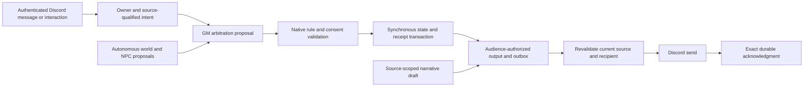

# Source-to-publication authority trace

Static trace at `f43d002693cb4ee38038b5dbb2c1049de95b3ffd`; these are actual source symbols, not executed gameplay acceptance results. Every proposed boundary keeps existing exception, ordering, source hash, principal, audience, native receipt and retry semantics.

| Existing seam | Actual symbols and inspected responsibility | Destination contract / unchanged authority |
|---|---|---|
| Discord command input | `commands.js:handleCommand`, `handleCommandBody`, role checks and interaction handlers; `idempotency.js:installReceiptCapture`, `replayReceiptIfPresent` | Discord transport → owned operation. Operation/mutation receipts remain paired with exact interaction and actor; no forged principal |
| Message intake | `index.js:resolveController`, `routeGameplayIntake` from `gameplay-intake.js`; `conversation-principal.js:conversationPrincipal` | Discord/session/intent pairs composed by a message workflow. Attendance is not fictional arrival or consent |
| Authored source | `authored-turn-envelope.js:captureAuthoredTurnEnvelope`, `recordNativeConsumedSpans`; source span ledger | Intent retains exact declaration, quote/OOC classification, source message, controller and consumed spans |
| Arbitration | `gm.js:GMService.runTurn`, `scene-intent-board.js:createArbitrationOrigin`, `gm-unified-arbitration.js:applyUnifiedArbitration`, `rules-arbitration.js:adjudicateAcceptedIntent` | Typed proposals and rule/owner/source validation; writer/model cannot commit dice, resources or PC decisions |
| Authoritative transaction | `turn-orchestration.js:commitGmTurn` calls `db.transaction`; `state.js:applyAuthoritativeMutation` retains nested synchronous transaction. Native RNG is called in final commit, not preview | Application workflow coordinates native resolvers and storage pairs in the same unit of work; effects, outcome receipts, turn stage and outbox remain atomic |
| Narrative acceptance | `narrative-authority.js:authorNarrativeRequests`; `pvp-output.js:prepareAuthorizedTurnOutput`, `validateOutputPart`, `revalidateOutputPublication` | Narrative accepts only entitled, source-bound fiction; provisional invention stays distinct from canonical/effect authority |
| Outbox | `publication-outbox.js:queueTurnPublications`, `deliverTurnOutbox`; `db.js:claimPublication`, `updatePublication` | Exact payload hash, recipient, ordinal and native source preserved. Atomic SQLite claim permits one sender. Await occurs outside the native commit transaction |
| Public transport | `publishing.js:deliverQueuedTurn` revalidates before actual `ch.send` | Discord/publication pair returns exact message/channel ID; it does not reauthor or retry uncertain delivery |
| Private transport | `publishing.js:sendPlayerPrivate`; `discord/privacy.js` and output/principal verification | Owner/character scope and private-channel entitlement rechecked. GM fallback/relay stays private; another owner's material is excluded |
| Acknowledgment/archive | `publication-outbox.js:deliverTurnOutbox` validates receipt, transactionally updates outbox and records archive/memory acknowledgment | Delivered status follows actual exact transport receipt, never successful prose generation or voice playback |
| Opening restart/refresh | `session-opening.js` attempt/epoch proofs; `session-opening-runner.js` prepared-refresh status claim; `session-opening-recovery.js` exact-state reviews | Preserve initial attempt, manual attempt 2, bounded uncommitted epoch and all ACKs. Proven no-commit recovery cannot bypass committed/unknown sends |
| World/NPC initiative | `autonomous-world.js`, `simulation.js:runNpcDirector`, `world-narrative-bridge.js:worldDirectorBridgeBeats` | Source-qualified autonomous actors remain active independently of PC engagement; beliefs, GM plans and player facts stay distinct |

## Audience lanes and proposal boundary

Public/party output has no automatic PC witness or shared knowledge grant. Character/owner-private material retains its subject and current controller. GM hooks, private seeds, hidden causes and full planner prose are not writer/public inputs merely because a nested field says public. Contradictory privacy labels preserve the restrictive authority. Private narration does not establish a PC's action, emotion, travel or consent.

`turn_attempts.committed` distinguishes `no`, `yes` and `unknown`. `publication_outbox.status` distinguishes pending, delivering, delivered, failed and uncertain; only failures with genuine no-send proof may be retried under the existing protocol. The `mutation_ledger`, `operation_receipts`, `world_events` → `city_records` foreign key and the outbox's `(turn_id,surface,ordinal)` identity must survive repository extraction unchanged.

## Evidence limits

Source inspection supports this responsibility/transaction map. No Discord input was accepted, RNG sampled, campaign database opened, provider called or historical gameplay test executed for RF00. End-to-end request/roll/privacy/restart equivalence needs newly authored changed-code tests when RF03–RF06 modify those contracts. Provider quality and production behavior remain unqualified.
