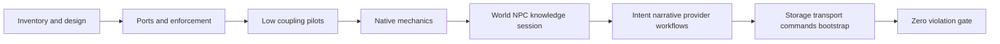

# Incremental migration and risk gates

The supplied RF roadmap has 50 features. Only RF00 phase/feature documentation is active in this checkpoint. Future rows are dependencies, not completion records or generated empty framework directories.

| Phase | Features | Preconditions | Exit evidence |
|---|---:|---|---|
| RF00 | F01–F06 (6) | Actual checkout and full owner/protocol authority | Complete ownership, graph, contracts/receipt trace, migration design, fresh audit-tooling tests; no runtime edits |
| RF01 | F01–F06 (6) | RF00 coherent source inventory | Actual framework ownership contracts, observed ports, public APIs, executable boundary checker with negative fixtures, exact pair lifecycle and scoped transition manifest |
| RF02 | F01–F06 (6) | RF01 enforcement and representative port contracts | Small pure/kernel/content/operations/character/Discord moves; stable paths and fresh path tests; errors policy extracted before kernel move |
| RF03 | F01–F06 (6) | RF02 mechanics dependencies and unit-of-work contract | Dice/rules/combat/PvP/consent/native features and environment responsibilities isolated; source-qualified native outcomes and replay tests |
| RF04 | F01–F07 (7) | RF03 native receipt ports; RF01 pair rules | World, NPC, knowledge and session contracts; current third-owner bridges decomposed; privacy, independent actor behavior, late attendance/replay tests |
| RF05 | F01–F06 (6) | RF03/04 domain ports | Provider, interpretation and narration isolated; GM/state/turn workflows decomposed without policy duplication or creative restrictions |
| RF06 | F01–F07 (7) | Domain interfaces and exact commit contract from RF03–05 | SQL repositories, outbox/Discord transport, command families and bootstrap isolated; original transaction/receipt and saved-reader semantics retained |
| RF07 | F01–F06 (6) | All preceding changed slices independently tested | Supported tooling wrappers/current docs finalized; zero unauthorized import edges, unowned modules, expired shims or inter-package cycles; one frozen fresh-only RF union |

## Per-module order

Use `SOURCE_RELOCATION_CROSSWALK.csv` and each edge in `PROJECTED_IMPORT_OBLIGATIONS.csv` to choose a cohesive slice. `PILOT_MOVE_CANDIDATE` is a static candidate, not approval that path/resource effects are absent. `EXTRACT_PORTS_BEFORE_MOVE` requires a boundary contract first. `DECOMPOSE_BEFORE_MOVE` forbids claiming success for moving the whole mixed implementation.

The large 211-module cycle prevents moving one connected framework cluster as a successful isolated package. Break an observed edge by a consumer-owned port and an exact pair adapter, inject it at composition, preserve a single transaction and remeasure the graph. A neutral hash/equality helper is not automatically kernel-owned merely because many domains import it: `sceneFictionHash` currently resides in a narrative-context module and requires semantic extraction/compatibility review.

Preserve actual startup wrappers `node src/index.js`, `node src/register-commands.js`, `Dockerfile` working directory `/app/bot`, and content/SQLite environment names. `import.meta.url`, schema path and content lookup assumptions must be tested in each relevant path move. Supported export/cost wrappers are inventoried; historical validators/test registries are never an executable shortcut.

## Risk and rollback gates

| Supported trigger | Material impact | Required gate / rollback |
|---|---|---|
| A moved module's relative ESM/resource URL changes | Startup/content/catalog lookup fails | Fresh actual new-path test; reverse only that physical move and its imports |
| Duplicate module identity creates another WeakMap/catalog or service singleton | Opaque grant identity/claims diverge | Preserve one public instance; fresh authority/claim tests before removing facade |
| Repository extraction introduces separate commits or async work inside native transaction | Partial effect, rolled back receipt or outbox mismatch | Share synchronous unit of work and nested savepoint semantics; hold that extraction until rollback test passes |
| Late source/control/audience change before send | Private leakage or stale-authority output | Revalidate current recipient/source and exact payload; never reauthor committed/unknown delivery |
| Retry or restart sees delivering/uncertain outbox | Duplicate real Discord message | Preserve claim/unknown states and exact authenticated reconciliation; no automatic resend |
| Removing an old render/proof reader | Saved native receipts/output become unverifiable | Retain historical reader and test newly built original-version fixture before facade removal |
| Domain splitting changes rule/narrative/PC-control behavior | Unauthorized gameplay change | Local hold and owner decision; independent behavior-preserving work continues |

No data migration is proposed. RF00 rollback removes only new audit tooling/tests and RF documentation, preserving the supplied handoff and owner changes. Future code rollback must retain any readers needed by subsequently persisted records. Missing evidence is a migration hold, not an invented proof or automatic rejection of the architecture.
